  <a href="https://suryapratik.vercel.app"><b>Portfolio</b></a> &nbsp;·&nbsp;
  <a href="https://www.linkedin.com/in/suryapratik/"><b>LinkedIn</b></a> &nbsp;·&nbsp;
  <a href="mailto:pratiksurya1207@gmail.com"><b>Email</b></a>

<b>Open to work</b> · AI/ML, software and Flutter internships · can join immediately

### About

I build AI products: voice agents, LLM-backed tools, Flutter apps and, when a product needs it, the hardware they run on.

- B.Tech CSE at **VIT-AP University**, 2023 → 2027 · CGPA 8.34
- From Bhilai, Chhattisgarh, India
- Growth comes from challenging yourself, embracing failures, and learning something new every day.

### Now

**Embedded Engineer Intern** at [Alfaleus Technologies](https://alfaleus.com) · since Jul 2026 · Hyderabad 
`voice AI → mobile apps → on-device ML → hardware builds`

- **Multilingual voice AI caller** on a Raspberry Pi: answers phone calls in Telugu, Hindi and English, replying in 1.2 to 2.5 s with no cloud telephony.
- **HR mobile app** in Flutter: put a desktop-only HR portal on employees' phones; 4 releases in 4 days, 401 automated tests.
- **GARBAE v3.0** AI waste-sorting bin: sorts fully offline on a Raspberry Pi; classification cut from ~14.6 s to ~2 s per item.
- **Droptor** eye-drop adherence device: 50 working units built and validated in one week with the team; 1st place at GLAUCOPAT 2026.

### Projects

Light in, six wavelengths out: each colour is a capability, the same mapping as on [the site](https://suryapratik.vercel.app).

**Software**

| | Project | What it does | Links |
| :-: | :-- | :-- | :-- |
|  | **TARANG** Oil-spill detection and vessel attribution · SIH 2026 | Finds a slick in Sentinel-1 radar, hindcasts its drift and ranks the ships responsible. Ranked 331 vessels on a real Arabian Sea spill, ~3 min per investigation. | [Live](https://tarang-mu.vercel.app) · [Case&nbsp;study](https://suryapratik.vercel.app/projects/tarang) |
|  | **DHARA** Dam hazard assessment and routing · SIH 2026 | Simulates dam-break floods and tells an officer when the water arrives, how deep it gets and who is affected. ANUGA RMSE 0.037 m against the analytic dam break. | [Live](https://dhara-frontend-indol.vercel.app) · [Case&nbsp;study](https://suryapratik.vercel.app/projects/dhara) |
|  | **ORCA** Satellite collision-risk screening | Screens a 15,968-object satellite catalog for one day of close approaches in 19 s, ranked into 5 risk tiers. | [Live](https://orca-vitap.vercel.app) · [Case&nbsp;study](https://suryapratik.vercel.app/projects/orca) |
|  | **SURRAG** Criminal network analysis | Links police FIRs into a Neo4j case graph with Qdrant search, so every lead has a citation behind it. | [Live](https://crimelink-frontend.vercel.app) · [Case&nbsp;study](https://suryapratik.vercel.app/projects/surrag) |
|  | **FlowIQ** Smart traffic app · RADIOTHON 2026 | Citizen app with maps, directions and challan payment; the team scored 98/100 in Round 1. I built the Flutter user app. | [Code](https://github.com/xeyynon/TUA) · [Case&nbsp;study](https://suryapratik.vercel.app/projects/flowiq) |
|  | **Telegram Drive** Encrypted cloud storage | Turns Telegram into encrypted storage: AES-256-CTR on the device, a fresh IV for every 48 MB chunk, streamed playback. | [Code](https://github.com/xeyynon/TelegramDriveStorage) · [Case&nbsp;study](https://suryapratik.vercel.app/projects/telegram-drive) |

**Embedded**

| | Project | What it does | Links |
| :-: | :-- | :-- | :-- |
|  | **Li-Fi Data Transmission** Best Contemporary Project · 1,000+ teams | Sends text and an 8×8 grayscale image as laser light pulses over a 50 m link, received by a solar panel. | [Code](https://github.com/xeyynon/Lifi-Data-Transmission-System) · [Case&nbsp;study](https://suryapratik.vercel.app/projects/lifi-data-transmission-system) |
|  | **CSI-Sense** Camera-free activity detection over Wi-Fi | Detects human presence and activity from Wi-Fi channel state information. I built the Flutter app and helped build the biquad antenna. | [Code](https://github.com/xeyynon/CSI-Sense) · [Case&nbsp;study](https://suryapratik.vercel.app/projects/human-presence-detection) |
|  | **EcoX** Emission and worker-safety device · SIH 2025 Semi Finalist | Raspberry Pi device with CO sensing, fire detection and 4G + GPS alerts. I built the Flutter dashboard. | [Code](https://github.com/xeyynon/ecoX) · [Case&nbsp;study](https://suryapratik.vercel.app/projects/ecox-industrial-safety) |
|  | **Water Quality Node** Prototype | ESP32 node that reports pH, TDS and temperature over 433 MHz LoRa every 3 s. | [Code](https://github.com/xeyynon/Water-Monitoring-Hardware) · [Case&nbsp;study](https://suryapratik.vercel.app/projects/smart-water-quality) |

### Capabilities

| | Capability | λ | Tools |
| :-: | :-- | :-- | :-- |
|  | **AI / ML** | 400&nbsp;nm | LLM integration (Gemini) · speech-to-text and text-to-speech streaming · computer vision (SigLIP2) · INT8 quantization · voice activity detection · scikit-learn |
|  | **Mobile** | 450&nbsp;nm | Flutter · Dart · Android · biometric auth · on-device OCR |
|  | **Web & Backend** | 500&nbsp;nm | FastAPI · React · Node.js · REST APIs |
|  | **Cloud & DevOps** | 560&nbsp;nm | Firebase · Supabase · PostgreSQL · Neo4j · Docker · Git · CI/CD (GitHub Actions) |
|  | **Languages** | 600&nbsp;nm | Python · Java · Dart · JavaScript · TypeScript · C/C++ · SQL |
|  | **Hardware** | 680&nbsp;nm | Raspberry Pi (embedded Linux, systemd) · ESP32-S3 · Arduino · I2C · Bluetooth / BLE · LoRa |

### Recognition

- **1st Place, Product Exhibition** · GLAUCOPAT 2026 · Droptor, 50 working units in one week with the team
- **Best Contemporary Project** · Engineering Clinics I (Fall 2024/25) · Li-Fi, among 1,000+ teams
- **Best Student Chapter** · Microsoft Student Chapter, VIT-AP · Fall 2025, as President · 8+ events, 300+ members
- **98/100 in Round 1** · RADIOTHON 2026 · FlowIQ
- **Semi Finalist** · Smart India Hackathon 2025 (EcoX) and 2024 (Vectr)
- **Top 20, Basic Track** · NEC '24, E-Cell IIT Bombay

One beam in, six wavelengths out · <a href="https://suryapratik.vercel.app">suryapratik.vercel.app</a>

