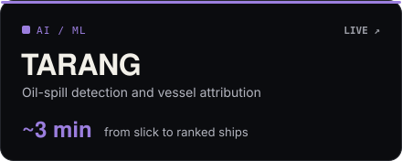
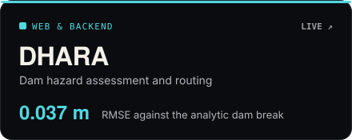
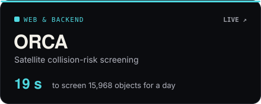
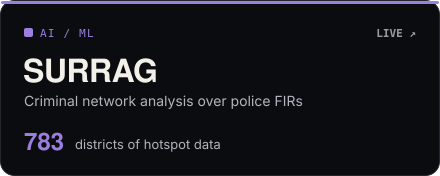
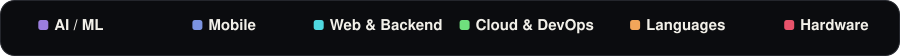

  &nbsp;
  &nbsp;
  

  Embedded Engineer Intern at <a href="https://alfaleus.com">Alfaleus Technologies</a>, building a multilingual voice AI caller 
  <b>Open to work</b> · AI/ML, software and Flutter internships

 

  
  
  
  

More projects

 

-  **Li-Fi Data Transmission** · Best Contemporary Project among 1,000+ teams · [code](https://github.com/xeyynon/Lifi-Data-Transmission-System)
-  **FlowIQ** · smart traffic app, 98/100 at RADIOTHON 2026 · [code](https://github.com/xeyynon/TUA)
-  **Telegram Drive** · encrypted cloud storage on Telegram · [code](https://github.com/xeyynon/TelegramDriveStorage)
-  **CSI-Sense** · camera-free activity detection over Wi-Fi · [code](https://github.com/xeyynon/CSI-Sense)
-  **EcoX** · emission and worker-safety device, SIH 2025 Semi Finalist · [code](https://github.com/xeyynon/ecoX)
-  **Water Quality Node** · ESP32 sensor node over LoRa · [code](https://github.com/xeyynon/Water-Monitoring-Hardware)

 

