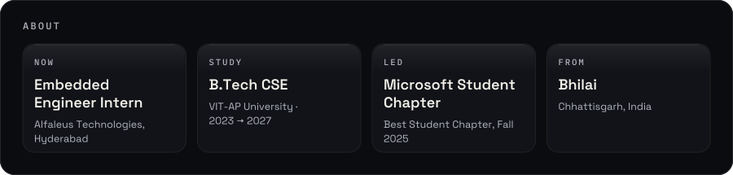

<a href="https://suryapratik.vercel.app">
  <picture>
    <source media="(prefers-reduced-motion: reduce) and (max-width: 600px)" srcset="assets/v3-hero-phone-still.svg">
    <source media="(prefers-reduced-motion: reduce)" srcset="assets/v3-hero-still.svg">
    <source media="(max-width: 600px)" srcset="assets/v3-hero-phone.svg">
    
  </picture>
</a>

<a href="https://suryapratik.vercel.app/#projects">
  <picture>
    <source media="(prefers-reduced-motion: reduce) and (max-width: 600px)" srcset="assets/v3-branches-phone-still.svg">
    <source media="(prefers-reduced-motion: reduce)" srcset="assets/v3-branches-still.svg">
    <source media="(max-width: 600px)" srcset="assets/v3-branches-phone.svg">
    
  </picture>
</a>

  <a href="https://suryapratik.vercel.app"><picture><source media="(max-width: 600px)" srcset="assets/v3-key-portfolio-phone.svg"></picture></a>
  <a href="https://www.linkedin.com/in/suryapratik/"><picture><source media="(max-width: 600px)" srcset="assets/v3-key-linkedin-phone.svg"></picture></a>
  <a href="mailto:pratiksurya1207@gmail.com"><picture><source media="(max-width: 600px)" srcset="assets/v3-key-email-phone.svg"></picture></a>

<picture>
  <source media="(max-width: 600px)" srcset="assets/v3-about-phone.svg">
  
</picture>
