<a href="https://suryapratik.vercel.app">
  <picture>
    <source media="(prefers-reduced-motion: reduce) and (max-width: 600px)" srcset="assets/scope-phone-still.svg">
    <source media="(prefers-reduced-motion: reduce)" srcset="assets/scope-still.svg">
    <source media="(max-width: 600px)" srcset="assets/scope-phone.svg">
    
  </picture>
</a>

  
  
  

<picture>
  <source media="(prefers-reduced-motion: reduce) and (max-width: 600px)" srcset="assets/about-phone-still.svg">
  <source media="(prefers-reduced-motion: reduce)" srcset="assets/about-still.svg">
  <source media="(max-width: 600px)" srcset="assets/about-phone.svg">
  
</picture>
